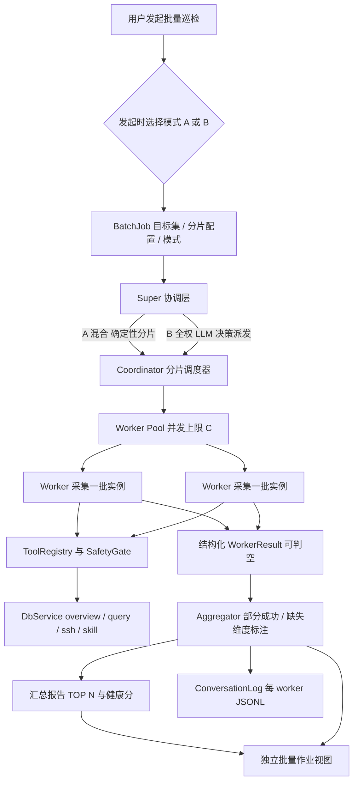

# 批量数据库巡检 · Super / Worker 架构设计

> **状态**：设计已完成，并按 U16 契约落地实现（2026-11-09）。本文保留原始设计推演；实际实现的取舍与偏差见文末「17. 实现状态与偏差」。
> **适用**：Routine（Electron 44 + TypeScript 5.9 严格模式 / React 19 + Zustand，主进程 CJS）
> **原始交付范围**：需求拆解、A/B 双模式、super/worker 协议、分片与并发模型、安全与防臆造守卫、独立作业视图、冻结区契约清单与分阶段落地路径。落地清单见 `CONTRACTS.md` U16 变更记录。
> **事实基线**：本文所有「现状」结论均来自对当前工作区源码的只读复核，路径与行号以当前代码为准。`.sisyphus/plans/*`（含 `db-inspection-architecture.md`）为历史规划，`CONTRACTS.md:42`（U13）已删除的巡检链路**不得视为现状，也不复活**。
> **硬约束**：`src/shared/types.ts`、`src/shared/ipc.ts`、`src/main/index.ts` 为冻结区（`CONTRACTS.md:3,54-55`）；`src/main/preload.ts` 仅追加式扩展（`:56`）；严格 TS，禁 `as any` / `@ts-ignore`；零原生模块依赖；左栏会话列表信息架构不变，资源入口仍放设置页。

---

## 目录

1. [背景与事实基线](#1-背景与事实基线)
2. [需求拆解与验收口径](#2-需求拆解与验收口径)
3. [双模式与「发起时询问」](#3-双模式与发起时询问)
4. [架构总览](#4-架构总览)
5. [Super / Worker 协议](#5-super--worker-协议)
6. [分片、并发与成本模型](#6-分片并发与成本模型)
7. [运行时解耦与并发调度](#7-运行时解耦与并发调度)
8. [安全、授权与 per-worker 隔离](#8-安全授权与-per-worker-隔离)
9. [防臆造守卫](#9-防臆造守卫)
10. [日志与可观测](#10-日志与可观测)
11. [独立批量作业视图](#11-独立批量作业视图)
12. [冻结区契约与目录所有权](#12-冻结区契约与目录所有权)
13. [分阶段落地路径](#13-分阶段落地路径)
14. [风险清单](#14-风险清单)
15. [待拍板的边界项](#15-待拍板的边界项)
16. [附录：关键接口草案](#16-附录关键接口草案)
17. [实现状态与偏差](#17-实现状态与偏差)

---

## 1. 背景与事实基线

Routine 现有的「数据库诊断」只是一次普通对话：`DbWorkbenchDiagnose.tsx:39-43` 把诊断提示词写入草稿 → 用户发送 → 单个 `Orchestrator` 跑 `skill.run` + 若干 `db.query` 只读 SQL → 末轮收敛 → 独立作答阶段出中文报告。特点：单数据源、串行、单上下文、无结构化报告落盘、无阈值判定与趋势。

`CONTRACTS.md:42`（U13，2026-10-26）已整体下线巡检体系：`inspectionStore` / `inspectionAlerts` / `inspectionRunner`、`DbService.inspect`、`inspection.run` 工具、全部 `inspection:*` 通道与 `CheckResult` / `InspectionReport` / `InspectionTrend` 等类型、`DatasourceConfig.thresholds`。根因是 3 个检查项均为静态或瞬时事实，通过率恒 ≈100%，趋势只反映手动点击次数。历史 `inspections.db` 留盘但不再读取、不迁移。`tests/db-prompt-context.test.js:65` 有断言「巡检已下线，不应再出现 inspection.run」。

### 1.1 现状可复用

| 能力 | 证据 |
|---|---|
| 单任务执行契约 | `Orchestrator.handleUserMessage(sessionId, text, emit, history?, refs?)`（`src/main/agent/orchestrator.ts:760-766`）、`msgId = crypto.randomUUID()`（`:786`）、`ChatService.runTurn`（`src/main/services/chatService.ts:40`）、`orchestratorEmit`（`src/main/ipc.ts:86`） |
| 工具与安全管道 | `ToolRegistry.execute` 的 `validate → effectiveRisk(riskFloor) → describe → createRequest / awaitApproval → def.execute`（`src/main/agent/tools/registry.ts:64-124`）；`ToolContext` 含 `scope` / `msgId` / `approval` / `signal`（`tools/types.ts:19-35`）；`SafetyGate`（`src/main/agent/safety.ts`） |
| 只读采集 | `DbOverview` 12 个顶层键 + `unavailable[]` 逐维独立降级（`src/shared/types.ts:414-428`、`src/main/services/db/overview.ts:35-43,510-520`），仅版本失败整体报错（`src/main/services/db/service.ts:200-205`）；`db.query` 只读守卫 |
| 已有守卫与预算 | `buildAnswerDigest` 48k / 16k 逐条保留（`src/main/agent/loop/answerDigest.ts:34-37,81-105`）、`findUnsupportedNumbers`（`loop/grounding.ts:124-146`）、`isAbandonmentText` / `claimsZeroYield`（U4/U6）、`DECISION_MAX_TOKENS=8192` / `TEXT_JSON_DECISION_MAX_TOKENS=4096`（`loop/limits.ts:9,15`）、FC `truncated` 半参丢弃（`loop/functionCalling.ts:53`）、`compactContext`（`orchestrator.ts:370-439,840`） |
| 日志与事件链 | `ConversationLog` 每任务 `<msgId>.jsonl`、`SAFE_ID` 白名单（`src/main/services/conversationLog.ts:8,141-153`）、`OrchestratorEvent → IPC → store`（`src/renderer/App.tsx:32-47`） |
| 目标约束底座 | `ResourceScope` / `assertDatasourceAllowed`（`src/main/agent/resources.ts:30-39,178`）；`preload.ts` 的 `CH` 表追加范式（`src/main/preload.ts:4-72`） |
| 巡检规格（文本手册） | `resources/skills/mysql-batch-health-check/SKILL.md`：6 维 `connections / disk / replication / slow queries / QPS / memory`（`:21`）、权重 20/25/20/15/10/10 与健康分（`:151-169`）、告警阈值表（`:324-331`）、TOP N 批量报告模板（`:195-238`）、Pattern A/B（`:41-56`）。**它是文本手册，无类型、无计算函数、无渲染组件** |
| 全屏视图范式 | `store.ts:145,408-413` 的 `dbWorkbenchOpen`、`App.tsx:59` 条件渲染、`DatabaseWorkbench.tsx:71` 全屏 `modal-overlay`、`Topbar.tsx:8,37` 主入口 |

### 1.2 必须新建

1. **领域类型与 IPC 通道**：`src/shared/**` 对 `Job|Worker|Inspection|batch|Batch` **零命中**（`src/shared/ipc.ts:126-136` 的 `EventPayloadMap` 仅 9 个既有事件：`chat:delta`、`chat:error`、`agent:status`、`agent:trace`、`agent:todo`、`safety:request`、`log:entry`、`index:progress`、`todo:runs-changed`）。Job / worker 状态机、聚合、进度/取消/超时、报告落盘全部需新建。
2. **并发执行层**：`busy` 是 `Orchestrator` 实例级单飞锁（`orchestrator.ts:198,768-769`，`busy=false` 在 `handleUserMessage` 的 finally `:773`）；`scheduler.maxConcurrent() ≡ 1`（`src/main/services/scheduler.ts:179-185`，唯一调用点 `:185`）；工具调用逐个 `await`（`orchestrator.ts:959-972`）。**全应用任何时刻只有 1 个任务在跑，且工具串行**。
3. **目标「分配」语义**：`ResourceScope` 来自会话 `@` 引用，是「限制」语义且空数组/缺省 = 不限制、`MAX_SESSION_REFS = 10`（`src/shared/types.ts:127`）；`skill.run` 的 `datasourceId` 明确不在校验范围（U15，`CONTRACTS.md:44`）。600 台清单无法用会话 refs 承载。
4. **健康分 / TOP N 的代码化**：目前只存在于 `SKILL.md` 文本。
5. **批量作业视图与报告落盘**：当前无多 worker 泳道、任务 DAG、按 worker 的 pending/running/failed 状态、汇总报告视图。

### 1.3 明确不可当作现状

- `.sisyphus/plans/db-inspection-architecture.md` 头部自述「仅架构规划，未实施」，其 `TodoTask.kind='dbInspection'`、`InspectionReport`、`inspection:run`、`inspection:progress`、`maxConcurrent 1–8`、`DbInspectionView` 均已被 U13 删除或被取代。
- `.sisyphus/plans/react-mcp-architecture.md:50` 明确「不做多 Agent 并行编排 / 子代理生成」；全库搜 `subAgent|multiAgent|worker|spawn|delegate` 零命中。`AgentName`（`src/shared/types.ts:150-180`）只是 8 个工具域的状态徽标，不是独立 agent 实例。
- `tools/builtin/skill.ts:22` 的适配头明确降级：「多实例/CMDB 类手册在本环境按单数据源执行（对应手册的单实例模式）」；`:20` 把 `db_query / db_get_status / db_get_variable` 映射为 `db.query` 等价 SQL。这是本次需求最直接的现状缺口。

---

## 2. 需求拆解与验收口径

**场景**：一次发起覆盖 100–600+ 台 MySQL / PostgreSQL 实例，全程只读，产出可核对的汇总健康报告（TOP N 异常 + 健康分分布 + 单机下钻）。技能手册宣称 600+ 实例 10 分钟（`:18`），此为设计目标量级，非承诺。

**角色**：super（指挥 / 收敛）· worker（一批实例的只读采集 + 本地归因）· coordinator（确定性分片 / 限流 / 重试）· aggregator（结构化聚合，非 LLM 编造）· 作业视图。

**验收口径不是「跑完了」**，而是：

- 每台实例都有明确结论，**或**明确的「未获取」原因；
- 报告里每个数字都能回溯到一次真实采集（`evidence`）；
- 单实例失败不影响作业，部分成功是正常完成态；
- 缺失维度显式标注，不允许用「无数据」推断健康或趋势。

**非目标**：

- 写操作与变更（严格只读）；
- 长期趋势 / 通过率 / 历史对比——U13 下线根因正是「通过率恒 ≈100%、趋势只反映点击次数」，本次只做本期快照；
- CMDB 集中代理（技能手册 Pattern A 在本环境不存在）；
- 把 600 台清单塞进 `ChatSession.refs` 或单条对话上下文。

---

## 3. 双模式与「发起时询问」

两种指挥方式**共用同一套 Job / Worker 协议**，差异只在「谁决定派发」，避免两套实现。

| | A 混合（默认推荐） | B LLM 全权编排 |
|---|---|---|
| 分片、并发、重试、限流 | 代码确定性 | super LLM 决策派发，代码仅执行护栏 |
| super 的 LLM 用在 | 异常归因、跨库对比、一次总报告 | 分片策略、读 worker 摘要、决定补检、再收敛 |
| LLM 决策轮量级 | 约 `ceil(N/B) × R + 少量归因 + 1` | 同上但含补检轮，需预算封顶 |
| 可预测性 / 成本 | 高、可事前估算 | 低、需硬护栏 |
| 适用 | 例行晨检、合规巡检、大批量 | 目标集不明、需按初步结果决定深挖哪些库 |

**B 模式护栏（必须）**：最大派发轮次、单作业 LLM 调用预算、禁止同一实例无限补检、所有派发仍走同一 coordinator 的并发与授权闸门。否则「自主」会变成不可控成本。

**「发起时询问用户使用哪种方式」的交互定义**：

1. **触发时机**：点击 Topbar「批量巡检」→ 选择目标数据源集合（分页 / 搜索 / 全选，仅列 `enabled`）→ **创建作业前**弹出模式选择，不默认直接开跑。
2. **选项文案**：A「稳妥模式 · 规则调度，成本可预估」；B「自主编排 · super 自行分片与补检，更灵活、模型调用更多」。同时展示当前目标数、预计 worker 数、预计 LLM 调用次数估算，让用户选得有依据。
3. **「记住我的选择」开关**：默认不勾选（每次询问）；勾选后偏好经现有 `settings:get/set` 落盘（不新增通道），下次跳过弹窗；作业头仍显示模式徽标，可一键切换。
4. 选择结果写入 `BatchJob.mode`。A/B 走同一状态机与结果契约，不产生重复派发。

---

## 4. 架构总览



四层设计：**确定性批次协调层 + 可多开的 worker 运行时 + 结构化结果 / 聚合层 + 独立作业视图层**。

---

## 5. Super / Worker 协议

**作业生命周期**：`created → running → aggregating → completed`（或 `canceled`）。部分成功是 `completed` 的一种，带 `partial: true`，**不是失败**。

**worker 状态机**：`pending → running → succeeded | failed | timeout | canceled`，带心跳与超时回收。

**派发单元**：一批 `datasourceId`，而非单库。

**关键约束**：

- worker 只回本批事实，**禁止输出全局结论**；super 汇总阶段只读 `WorkerResult`，不读 worker 自由文本。
- 结果幂等：按 `jobId + datasourceId` 去重；同一实例被重试两次不能算 2 台。
- 取消广播贯穿 LLM 请求（`signal`）、工具执行与未决审批（复用 `abort()` 中的 `safety.cancelAll('用户中止任务')` 语义，`src/main/agent/safety.ts:134-138`），避免 120s 审批超时把作业挂住。
- 作业中断后从已落盘的实例结果续跑，只补 `pending / failed` 项。
- 可重试错误限定为连接失败 / 超时 / 临时不可达；权限、SQL 语法错误、用户拒绝不重试；`maxRetries` 与退避由 coordinator 统一管理，B 模式的「补检」也必须过同一道闸门。

**聚合口径**：`completed` 时给出成功数 / 失败数 / 未获取维度数；`unavailable` 一律写「未获取（原因）」；健康分仅在维度齐全时计算；禁止与历史比较。聚合只扫成功结果做 TOP N 排序（O(N log N)），空间 O(N × 维度)。

---

## 6. 分片、并发与成本模型

设 N＝实例数，B＝每批实例数，C＝并发上限，R＝每 worker LLM 决策轮：

- worker 数 ≈ `ceil(N/B)`；LLM 决策轮 ≈ `worker 数 × R + 归因/汇总`；SQL 次数 ≈ `N × 维度数`。
- 示例：N=600、B=20 → 30 个 worker，C=4~6，6 维 → 约 3600 次只读查询。若按「一库一 LLM worker」则是 600 次 LLM 会话，调用量与时长不可控，**不采用**。

**核心取舍：采集与推理解耦**。采集走确定性路径——`DbOverview` 一次性实时采样（各维独立 try/catch、`unavailable[]`）+ 技能手册白名单 SQL（6 维，权重来自 `SKILL.md:151-169`），天然产出结构化结果；LLM 只用于「异常实例的归因」「跨库对比」「一次总报告」。A 模式甚至可把采集轮 LLM 调用降为 0。

worker 的「agent 性」不靠多起 LLM：每个 worker 是独立的 `AgentRunner` 上下文（独立 messages / strategy / abort / msgId / 日志 / scope / todo 基线），可自主决定采集顺序、按维度失败做局部重试；但对外只交结构化结果。

**瓶颈与缓解**：LLM 请求用独立信号量 L（≤ C）；DB 连接按 `datasourceId` 缓存复用（`src/main/services/db/service.ts`）；每实例 statement 超时；同类只读查询同轮 `actions` 合并；结果**按实例增量落盘**；`compactContext` 与 `buildAnswerDigest`（48k / 16k）预算继续生效，禁止 600 台的原始结果挤进单一上下文。

**成本可见性**：发起弹窗展示预计 worker 数、LLM 决策轮、SQL 次数与耗时区间；作业运行中在进度条展示实际计数。

---

## 7. 运行时解耦与并发调度

**不能就地改单例**。`Orchestrator` 的下列字段都是实例级共享状态，必须整体抽成「每任务一份」的 `AgentRunner`：

- `busy`（`orchestrator.ts:198`）、`aborted` / `abortController`（`:196-198`）；
- `refsBlock` / `scope`（`:1136-1140` 的 finally 只清这两个，不清 abort，也不清 busy）；
- `msgId`（`:786`）、`TaskRunLog`、`taskObservations`、messages / strategy；
- `todo.write` 的 session 级基线（U7，`CONTRACTS.md:30`）——按 worker 隔离，否则批量作业会串改同一份清单。

`getOrchestrator()` 当前返回裸 `Orchestrator` 实例（`src/main/composition.ts:77-87`），改为「单任务 Orchestrator 与批量作业运行时并存」，避免互相抢占；`ChatService.runTurn` 与定时任务路径保持不变。

**工具有界并发**：把 `orchestrator.ts:959-972` 的 `for…await` 换成带信号量的并发执行。FC 已能一轮返回多个 `tool_calls`（`loop/functionCalling.ts:41-56`），无需改协议；只需保证 `observations` 按原顺序回填，否则 `buildAnswerDigest` 的序号会错乱。C=1 时与现有行为等价，单任务路径不回归。

**并发预算隔离**：`scheduler.ts:179-185` 的 `maxConcurrent()` 由硬编码 1 改为「定时任务单飞 + 批量作业独立并发预算」，两套预算互不饿死。配置项 `SchedulerConfig.maxConcurrent` 虽仍存在，但 M3 已废弃，不应复用（`src/shared/types.ts:38-41,104`）。

---

## 8. 安全、授权与 per-worker 隔离

**批量授权**：现状 `ToolRegistry.execute` 对每个非 safe 调用都 `createRequest → awaitApproval`（`tools/registry.ts:84-123`），审批默认 120s（`safety.ts:14`）；`ssh.exec` / `db.exec` 有 `riskFloor: 'medium'` 且不可下调（`safety.ts:60-65`、`tools/types.ts:69-73`）。600 台逐次弹窗等于不可用。设计：

1. 默认采集只用 safe 工具（`db.query` 只读守卫、`db:overview` 采样、`skill.run/read`），**作业内不触碰 medium 工具**，从源头消灭弹窗。
2. 若维度扩展确实需要主机指标（`ssh.exec`），改为「作业级一次性授权」：授权对象 = `jobId + 工具名 + 数据源/主机集合 + 维度 + 有效期`，审批弹窗明确展示范围与调用上限；每次实际调用仍逐条写 `AuditEntry`（带 `detail` / `msgId` / `jobId` / `workerId`），可审计、可撤销。`riskFloor` 绝不因批量而降级，high 操作仍禁止。
3. 越界调用在 `validate` 阶段被拒（`registry.ts:73`），不产生审批、不消耗 LLM 轮次。

**per-worker 隔离**：现有 `ResourceScope`（`agent/resources.ts:30-39`）是会话 `@` 引用的「限制」语义，`MAX_SESSION_REFS=10`（`src/shared/types.ts:127`），无法承载 600 台。批量场景改为**分配**语义：

- worker 绑定本批 `datasourceId` 白名单 + 工具白名单；
- `db.query` / `db.exec` 的 `assertDatasourceAllowed` 按 worker 校验；
- `skill.run` 的 `datasourceId` 补进校验范围（U15 的缺口）；
- `db.list` 的 `promptContext()` 目前把**全量数据源清单**注入快照（`tools/builtin/db.ts:59-67`），批量场景必须只注入本批清单，否则 worker 看得见 600 台、容易跨库误采。

**凭据隔离**：沿用 `omitSecretFields(ds, ['password'])`（`tools/builtin/db.ts:9-14`）与 `redactSecrets`，模型与日志都只见 `name / type / id / host:port / database / enabled`，绝不含凭据。

---

## 9. 防臆造守卫

对齐本项目已发生的事故链（U4 / U6 / U7 / U9 / U12，`CONTRACTS.md:27,29,30,34,40`）：

| 风险 | 防线 |
|---|---|
| worker 各自编造全局结论 | 聚合唯一输入是 `WorkerResult` 结构化字段；worker 自由文本不进汇总；UI 直接渲染数字 |
| 「0 行」被当成健康（假阴性） | `db.query` 空结果语义化、0 行必须带 SQL 复核（U7；`tests/answer-phase.test.js:225-232`、`tests/db-prompt-context.test.js:58-63`）；`status` 置 `unavailable` 而非 `ok` |
| 6 维只跑 3 维却出完整报告 | 决策轮预算 `DECISION_MAX_TOKENS=8192` / `TEXT_JSON_DECISION_MAX_TOKENS=4096`（`loop/limits.ts:9,15`）——U12 事故根因正是决策轮缺省 2048 被截断；每 worker 与汇总阶段各自带预算，维度不齐不出健康分 |
| 半截 SQL 打到实例上 | FC `truncated` 时参数 JSON 不完整的调用一律丢弃（`loop/functionCalling.ts:53`），批量下这条更关键 |
| 600 条同形状结果被压缩成 1 条 | `buildAnswerDigest` 48k / 16k **逐条保留、不做同文案去重**（`loop/answerDigest.ts:34-37,81-105`）；汇总不依赖对话上下文——`compactContext` 16k 归档（`orchestrator.ts:370-439,840`）会把早期实例证据压成占位，必须读结构化结果存储 |
| 报告数字无来源 | `findUnsupportedNumbers`（`loop/grounding.ts:124-146`）做数值溯源；报告每个数值须能回溯到某次采集的 `evidence` |
| 局部失败 → 模型整体放弃 | `isAbandonmentText` / `claimsZeroYield` 一次性重写（U4/U6；`tests/final-guard.test.js:62-67,151-163`）；U4 适配头「单步失败不整体放弃」升级为「单实例失败不影响作业」 |
| 编造趋势 / 基线 | 只做本期快照，缺失维度显式「未获取」，禁止与历史比较（U13 下线根因） |
| 重试导致重复计数 | `jobId + datasourceId` 幂等去重，报告按实例唯一键统计 |

---

## 10. 日志与可观测

复用 `ConversationLog` 每 worker 独立 JSONL（`SAFE_ID` 白名单 `conversationLog.ts:8`、`TaskRunLog` 的 `round / event / tool / safety / final / fatal` 等方法 `:268-282`）、`scope: task | infra` 标记（U9）、`orchestratorEmit → sendToRenderer → store` 事件链。错误须带 `jobId / workerId / datasourceId / msgId` 可定位；不喷日志、不写凭据与 PII。

**必须新建的缺口**：`conversationLog.ts:5,256-265` 的 `prune()` 全局只保留 50 个文件，30+ worker 一跑就会挤掉普通会话日志。需改为「作业级日志目录或按 `jobId` 聚合文件 + 独立保留策略」，不能让批量作业污染既有对话日志。

---

## 11. 独立批量作业视图

**入口与形态**：复用 `DatabaseWorkbench` 的既有范式——`store.ts:145,408-413` 的 `dbWorkbenchOpen` 布尔开关 + `App.tsx:59` 条件渲染 + `DatabaseWorkbench.tsx:71` 的全屏 `modal-overlay`（`role="dialog" aria-modal="true"`，`:46-52` Escape 关闭）+ `Topbar.tsx:8,37` 主入口。新增 `batchJobOpen` / `activeJobId` 独立开关；设置页数据源区保留一个文字入口。**左栏会话列表完全不变，资源入口仍在设置页**，不新增常驻侧栏，整个视图可用一个布尔值整体回退。

**五区块（自上而下）**

1. **作业头**：作业名、模式徽标（混合 / 自主编排）、目标数量、发起 / 停止、返回；单行工具条，不占左栏宽度。
2. **总进度概览**：成功 / 失败 / 运行中 / 耗时 / 当前并发 / 实际 LLM 调用计数 + 分段进度条；数值全部来自真实计数，缺失显示「—」，绝不估算填充。
3. **worker 泳道**：按状态分组的卡片，每卡显示批名、状态点、当前步骤、耗时、失败原因摘要、「重试」「查看日志」入口；单行省略、悬浮展开。
4. **汇总报告**：TOP N 异常表（按严重度排序）、健康分分布、维度筛选；行点击下钻单实例 6 维详情，逐维展示 `evidence`（SQL / 耗时 / 行数），缺失维度显式「未获取（原因）」，不显示推断结论。
5. **底部状态条**：全局告警摘要、批量重试失败项、导出、「在对话中诊断」——复用 `DbWorkbenchDiagnose.tsx:39-43` 的 `prefillComposer` + 关闭弹窗范式（写草稿，不自动发送）。

**视觉**：沿用 `styles.css` 的令牌体系（M5 三层令牌、success / warn / danger 语义变体、深浅色一致），不引入第三方组件库、不用裸色；状态语义色只用于状态点与进度；短促微动效反馈进度推进 / 失败置红 / 重试回蓝；高密度信息但保留留白与分组分隔；按窗口宽度收敛泳道列数，报告表格优先保证可读。

**状态管理必须新建**：`runningSessionId` 是单值单会话锁（`store.ts:153,300,354`），`TurnTrace` 有 `MAX_TURNS=20 / MAX_TRACES=499` 上限（`store.ts:35-36`），都承载不了 600 台轨迹；`App.tsx:32-47` 只订阅 9 个通道，U1 已移除 `onTodoUpdate`。需新增独立作业 slice（作业快照 / worker 列表 / 实例结果 / 报告）与自有裁剪策略，进度事件走新的 `EventPayloadMap` 条目 + `preload.ts:74-80,145-153` 的 `subscribe` 追加范式。

---

## 12. 冻结区契约与目录所有权

| 文件 | 追加内容 | 约束 |
|---|---|---|
| `src/shared/types.ts`（FROZEN） | `BatchJob` / `WorkerState` / `DimensionResult` / `WorkerResult` / `JobSnapshot` / `JobReport`；`Settings` 增批量配置（`batchSize` / `concurrency` / `llmBudget` / `modePreference`） | **不改** `MAX_SESSION_REFS=10`、`ChatSession.refs`、已废弃的 `SchedulerConfig.maxConcurrent` |
| `src/shared/ipc.ts`（FROZEN） | 作业 create / start / cancel / retry / report 等 invoke 通道 + `EventPayloadMap` 进度事件 + `RoutineApi` 方法 | 通道字符串与 preload 逐字一致 |
| `src/main/preload.ts` | `CH` 表与 `api` 追加条目 | 仅追加，既有条目不动（`CONTRACTS.md:56`） |
| `src/main/index.ts` | 无 | 冻结只读，不动 |
| `CONTRACTS.md` | 追加 U16 变更记录（比照 U13 / U15 格式） | 写明 U13 已删项**不复活**、历史 `inspections.db` 不读不迁移、报告用新 `batch job` 命名空间落盘 |

**目录所有权**（`CONTRACTS.md:46-52`）：A 核心代理写 `src/main/agent/**` 与 `src/main/ipc.ts`（`AgentRunner`、coordinator、worker 协议、进度发播）；B 服务代理写 `src/main/services/**`（作业存储、结果增量落盘、聚合器、作业级日志保留策略）；C 界面代理写 `src/renderer/**`（视图与状态 slice）。冻结区变更单独列作契约提案，须编排者批准。

---

## 13. 分阶段落地路径

| 阶段 | 交付 | 验收 / 回归关注 |
|---|---|---|
| P0 契约 | 冻结区类型 / 通道清单、`CONTRACTS.md` U16 变更记录、目录所有权分工 | 逐条对照 U13 已删项无冲突；`tests/db-prompt-context.test.js` 不回归 |
| P1 运行时 | 可多开 `AgentRunner` + 有界并发工具调度 + 定时任务与批量作业并发预算隔离 | C=1 时与现行为等价；`busy` / `abort` / 审批取消不串扰；`tests/react-loop.test.js:603-635,754-786`（truncated 纠正重试）全绿 |
| P2 协议 | Job / worker 状态机、结构化结果契约、取消 / 超时 / 重试 / 续跑、部分成功聚合 | 幂等去重、缺失维度显式标注；`tests/answer-phase.test.js`、`tests/final-guard.test.js` 防假阴性不回归 |
| P3 安全与观测 | per-worker scope、工具白名单、作业级一次性授权、只读守卫、作业级日志保留策略 | `riskFloor` 不可降、无逐窗轰炸、50 文件 `prune()` 不污染会话日志；`tests/db-overview.test.js:99-118,180` 的 `unavailable` 降级保持 |
| P4 视图与汇总 | 全屏批量作业视图、TOP N 报告、单机下钻、报告落盘 | 左栏不变；`runningSessionId` 不被误用；日志 `scope` 正确；深浅色令牌无裸色（`tests/theme-tokens.test.js`） |
| P5 双模式 | A/B 编排与「发起时询问」交互 | 两模式共享同一协议、模式切换不重复派发、B 模式预算封顶生效、偏好走现有 `settings:get/set` |

每阶段收尾做一次「现状可复用 / 必须新建」逐条自审，确保不臆造现状、不复活已下线巡检体系。

---

## 14. 风险清单

1. **单例解耦爆炸半径最大** → P1 独立小步，保留旧路径与特性开关。
2. **600 台成本与时长失控** → 采集 / 推理解耦 + 事前估算 + 预算护栏。
3. **批量假阴性（最高风险，本项目真实发生过）** → 结构化结果与第 9 章全部守卫；U12 的事故即「决策轮 2048 截断 → 6 维巡检只落地 3 项」。
4. **审批弹窗风暴** → 默认 safe 工具 + 作业级一次性授权。
5. **日志 `prune()` 挤掉会话日志** → 作业级日志目录与独立保留策略。
6. **界面信息架构回退风险** → 2026-11-02 曾以「左侧太凌乱」否决三栏工作台改造；本次用全屏弹窗 + 左栏零改动 + 布尔开关可整体回退。
7. **冻结区改动未批准** → P0 前置，未经批准不落地。

---

## 15. 待拍板的边界项

不阻塞本设计，进入实现前确认：

- 定时批量巡检：复用 `scheduler`（当前 `pump()` FIFO、`RETRY_DELAY_MS=15min`、24h catch-up）还是独立入口；
- 报告保留期，以及是否要跨次对比（U13 已下线趋势，若要即为全新能力）；
- 异常是否接既有 `notifier` 的 6h 去重通知。

---

## 16. 附录：关键接口草案

> **设计提案，非现有代码**。落地须经编排者批准冻结区。

```ts
interface BatchJob {
  id: string;
  mode: 'hybrid' | 'llm-full';       // A 混合 / B LLM 全权
  datasourceIds: string[];
  batchSize: number;                  // B：每 worker 负责实例数
  concurrency: number;                 // C：并发 worker 上限
  dimensions: readonly string[];      // 技能手册 6 维
  timeoutMs: number;
  maxRetries: number;
  llmBudget: number;                  // 决策轮上限，B 模式护栏
}

interface DimensionResult {
  name: string;
  status: 'ok' | 'warn' | 'error' | 'unavailable' | 'skipped';
  value?: number;
  evidence?: string;   // SQL / 耗时 / 行数；0 行必须带 SQL 复核
  reason?: string;    // unavailable / skipped 必填
}

interface WorkerResult {
  jobId: string;
  workerId: string;
  datasourceId: string;
  dimensions: DimensionResult[];
  healthScore?: number;  // 仅维度齐全时给出
  ok: boolean;
  attempt: number;
  durationMs: number;
}
```

**语义约束**：`WorkerResult` 只描述本批事实，禁止承载全局结论；`evidence` 为空的 `ok` 视为无效结果，聚合时按 `unavailable` 处理；健康分口径见第 17 章偏差 5。

---

## 17. 实现状态与偏差

**已落地**（`CONTRACTS.md` U16，2026-11-09）：

| 计划阶段 | 实现 |
|---|---|
| P0 契约 | 冻结区追加批量领域类型与 8 个通道（7 invoke + 1 事件）、`RoutineApi` 与 `preload.ts` 同步、U16 变更记录 |
| P1 运行时 | **新增独立 `BatchService`**（`src/main/services/batch/jobService.ts`），自带 worker 池、有界并发、per-job abort、节流增量落盘 |
| P2 协议 | `BatchJob` / `BatchWorker` / `BatchInstanceResult` 全量快照、取消 / 超时 / 有限重试 / 失败项续跑、`jobId + datasourceId` 幂等去重、部分成功聚合 |
| P3 安全与观测 | 采集只走 `DbService.overview`（等价只读白名单路径），作业内不触碰 medium 工具；作业级独立日志目录 `batch-logs/`，不污染 `ConversationLog` 的 50 文件窗口 |
| P4 视图与汇总 | `BatchInspectionView` 全屏弹窗：目标集选择、发起时模式询问与记住偏好、总进度、worker 泳道、TOP N 报告、单机 6 维下钻、停止 / 重试 / 导出 / 在对话中诊断 |
| P5 双模式 | A 混合（规则调度 + 可选 LLM 归因）/ B LLM 全权（自主补检 + 预算与轮次护栏 + 不可用时降级 A），共享同一协议 |

**与原始设计的偏差**（均为降低回归风险的工程取舍，已写入 U16）：

1. **不重构 `Orchestrator` 单例**。原设计 P1 要求「抽离可多开 `AgentRunner`」；实现改为新增独立运行时：super 用 `LLMRouter.getActive().chatStream()` 直连，worker 是并发的确定性只读采集单元（各自独立 abort / msgId / 日志 / 数据源白名单）。因此 `chat:send`、定时任务 `maxConcurrent()≡1`、既有 31 个测试文件全部零改动，避开改动 49KB 核心编排器的爆炸半径。
2. **worker 不经 `ToolRegistry`**。采集直接调 `DbService.overview()`（服务层已有 `assertReadOnlySql` 只读守卫），默认不涉及 `ssh.exec` / `db.exec`，批量场景没有逐窗审批；`riskFloor` 语义不变。per-worker 隔离由 `jobService` 的批次白名单实现，而非会话级 `ResourceScope`（后者仍是 ≤10 refs 的限制语义，未改）。
3. **模式偏好存渲染层 `localStorage`**（`routine.batch.mode`），不改 `Settings` / `DEFAULT_SETTINGS` / `loadSettings`，减少冻结区改动面。
4. **存储分层**：`batch-jobs.json` 只存作业索引（保留 50 条）；完整快照在 `batch-state/<jobId>.json`（原子写、节流），作业日志在 `batch-logs/<jobId>.jsonl`；`jobId` 复用 `SAFE_ID` 白名单防路径穿越。
5. **健康分口径修正**：草案写「任一维度 `skipped` 也留空」，实现改为 `skipped`（如未配置复制）不拉低分数、按剩余权重归一化；只有 `unavailable` 才不给健康分。依据 U13 事故：skipped 单列，不应计入得分/通过率。
6. **B 模式护栏具体化**：最多 3 轮决策、单轮最多 10 台补检、同一实例不重复补检、总 LLM 调用受 `llmBudget` 约束；任一环节失败即降级 A 并在作业上标 `degradedFrom`。
7. **汇总报告数字全部来自结构化结果**；LLM 只产出归因文字，失败时退回 `buildStructuredSummary`，报告其余部分完整——离线 / 无 API Key 也可用。

**未实现**（第 15 章待拍板项，仍需确认）：定时批量巡检、报告保留期与跨次对比、异常通知接 `notifier`。

**验证**：`npm run typecheck`、`npm test`（222 项全通过，含新增 `tests/batch-jobs.test.js` 13 项、`channels.test.js` 双表一致性、`theme-tokens.test.js` 令牌校验）、`npm run build`（Vite 306 模块）、`npx eslint`（改动文件零告警）。
